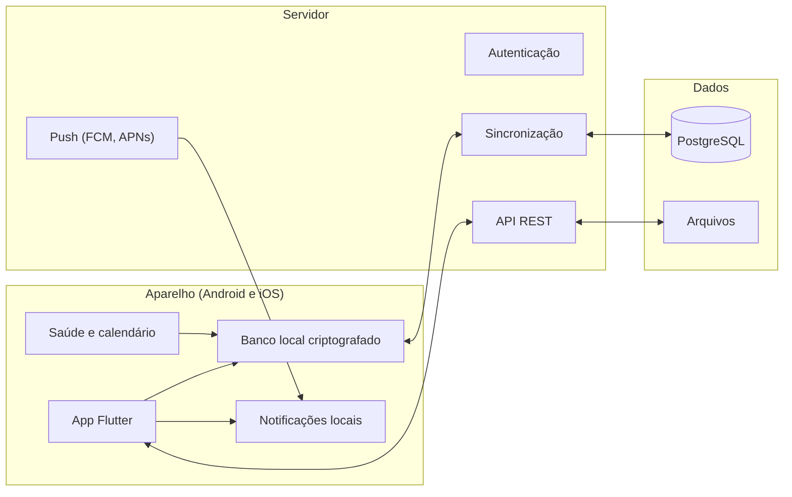

# Escopo do app de controle pessoal

Data: 2026-10-19 · Autor: Vhavah

## Visão e objetivos

O app reúne finanças, saúde e compromissos em um só lugar, para que o dia inteiro seja planejado e acompanhado em uma única tela, no Android e no iOS.

**Problema:** hoje contas, consultas, remédios e reuniões vivem em apps, planilhas e lembretes separados. Nada cruza essas informações (por exemplo: uma consulta cara que cai em semana de fatura alta, ou uma reunião que atropela o horário de um remédio).

**Objetivos**

- Ver, em uma tela "Hoje", tudo o que exige atenção: compromissos, remédios, consultas e contas a vencer.
- Registrar e acompanhar receitas, despesas, orçamentos e metas financeiras.
- Controlar consultas, exames, medicamentos e indicadores de saúde, com lembretes confiáveis.
- Gerenciar agenda e reuniões, com sincronização com o calendário do celular.
- Funcionar offline e manter os dados sincronizados entre aparelhos.

**Fora do escopo (versão 1):** multiusuário e compartilhamento familiar, integração direta com bancos (Open Finance), prontuário médico completo e telemedicina. Ficam como evolução na fase final do roadmap.

**Público:** uso pessoal, um usuário por conta, em celular Android e iPhone, com opção futura de versão web.

## Módulos e funcionalidades

São quatro módulos. Finanças, Saúde e Agenda funcionam sozinhos; a tela Hoje junta os três. A coluna Fase indica quando cada item entra (detalhes na seção Roadmap).

### 1. Finanças

| Funcionalidade | Descrição | Fase |
| --- | --- | --- |
| Contas e carteiras | Conta corrente, poupança, dinheiro, cartão de crédito, com saldo atual | 1 |
| Lançamentos | Receitas e despesas com valor, data, categoria, conta, anexo (foto de nota) e observação | 1 |
| Categorias e tags | Categorias padrão editáveis, subcategorias e tags livres | 1 |
| Contas a pagar e a receber | Vencimentos, recorrência, parcelamento, status pago/pendente e alerta de vencimento | 1 |
| Cartão de crédito | Fatura por ciclo, fechamento e vencimento, parcelas futuras | 2 |
| Orçamento mensal | Limite por categoria com barra de consumo e aviso ao chegar em 80% e 100% | 2 |
| Metas e reserva | Objetivos com valor-alvo, prazo e aporte mensal sugerido | 2 |
| Relatórios | Gasto por categoria, receita x despesa por mês, fluxo de caixa projetado | 2 |
| Importação e exportação | OFX e CSV de extratos; exportação em CSV e PDF | 3 |
| Multimoeda e investimentos | Moedas, carteira simples de investimentos | 4 |

### 2. Saúde

| Funcionalidade | Descrição | Fase |
| --- | --- | --- |
| Consultas e exames | Agendamento com médico, local, especialidade, preparo (jejum, documentos) e lembrete antecipado | 1 |
| Medicamentos | Nome, dose, horários, duração do tratamento, estoque e alerta de reposição | 1 |
| Registro de tomadas | Confirmar "tomei" ou "pulei" direto na notificação; histórico de adesão | 1 |
| Indicadores | Peso, pressão, glicemia, sono, água, passos, com gráfico de evolução | 2 |
| Integração com saúde do aparelho | Apple Health (iOS) e Health Connect (Android) para passos, sono e frequência cardíaca | 3 |
| Documentos de saúde | Fotos e PDFs de exames, receitas e laudos, vinculados à consulta | 2 |
| Vacinas e checkups | Calendário de vacinas e lembretes periódicos | 3 |
| Perfil de saúde | Alergias, tipo sanguíneo, contatos de emergência, acessível rapidamente | 2 |

### 3. Agenda e compromissos

| Funcionalidade | Descrição | Fase |
| --- | --- | --- |
| Eventos | Título, data, hora, local, participantes, notas, tipo (reunião, pessoal, saúde, financeiro) | 1 |
| Visões | Dia, semana, mês e lista de próximos | 1 |
| Recorrência | Diária, semanal, mensal, anual e regras personalizadas | 1 |
| Lembretes | Notificação local no horário e antecipada (ex.: 1 dia antes, 30 minutos antes) | 1 |
| Sincronização de calendário | Leitura e escrita no Google Calendar, calendário do iOS e Outlook | 2 |
| Tarefas | Lista de tarefas com prazo, prioridade e vínculo a um evento | 2 |
| Reuniões | Link de videochamada, pauta, ata e itens de ação | 3 |
| Detecção de conflitos | Aviso quando dois compromissos, ou um compromisso e um remédio, colidem | 2 |

### 4. Hoje (painel unificado)

| Funcionalidade | Descrição | Fase |
| --- | --- | --- |
| Linha do tempo do dia | Compromissos, consultas, remédios e vencimentos em ordem cronológica | 1 |
| Resumo financeiro | Saldo, contas que vencem em 7 dias, gasto do mês x orçamento | 2 |
| Pendências | O que ficou sem registro (remédio não confirmado, conta vencida) | 1 |
| Busca global | Pesquisa em lançamentos, eventos, consultas e documentos | 2 |
| Resumo semanal | Visão da semana seguinte e fechamento da semana anterior | 3 |
| Widgets de tela inicial | Próximos compromissos e remédios do dia no Android e no iOS | 3 |

## Requisitos não funcionais

O app guarda dados financeiros e de saúde, então segurança e privacidade pesam mais do que qualquer funcionalidade.

| Área | Requisito |
| --- | --- |
| Privacidade (LGPD) | Dados de saúde são dados pessoais sensíveis: consentimento explícito, política de privacidade clara, exportação e exclusão total da conta a pedido |
| Autenticação | Login com e-mail e senha ou conta Apple/Google, mais biometria (Face ID, digital) para abrir o app |
| Criptografia | TLS em todo tráfego; dados em repouso criptografados no servidor e no aparelho (SQLCipher ou equivalente); chaves guardadas em Keychain (iOS) e Keystore (Android) |
| Offline | Todas as telas principais funcionam sem internet; alterações entram numa fila e sincronizam ao reconectar |
| Sincronização | Entre aparelhos do mesmo usuário, com regra de conflito definida (última edição vence por campo; exclusões marcadas, não apagadas na hora) |
| Notificações | Locais para lembretes de horário (não dependem de internet); push apenas para avisos vindos do servidor |
| Desempenho | Abertura em até 2 segundos; lista de 10 mil lançamentos rolando sem travar |
| Backup | Backup automático no servidor; exportação manual completa (JSON e CSV) |
| Acessibilidade | Tamanho de fonte dinâmico, leitores de tela, contraste mínimo WCAG AA |
| Idioma e moeda | Português do Brasil e real na versão 1, com textos e formatos preparados para outros idiomas |
| Lojas | Cumprir as regras da Apple App Store e do Google Play, incluindo declaração de uso de dados de saúde |

## Stack e arquitetura

A recomendação é **Flutter no celular e PostgreSQL no servidor**, com banco local no aparelho para o uso offline. Um código só atende Android e iOS, e o PostgreSQL já faz parte do seu dia a dia. Esta é uma proposta para validar, não uma decisão fechada.

| Critério | Flutter | React Native (Expo) | GeneXus |
| --- | --- | --- | --- |
| Um código para Android e iOS | Sim | Sim | Sim, via aplicações para dispositivos móveis |
| Banco local e uso offline | Bom (SQLite com Drift ou similar) | Bom (SQLite, WatermelonDB) | Suportado, com limites a validar |
| Notificações locais e alarmes exatos | Bom, com plugins maduros | Bom, com plugins maduros | A validar para lembretes de remédio |
| Apple Health e Health Connect | Plugins disponíveis | Plugins disponíveis | Provável código nativo extra |
| Widgets de tela inicial | Via código nativo complementar | Via código nativo complementar | Provável código nativo extra |
| Aproveita sua experiência | Linguagem nova (Dart) | Linguagem nova (TypeScript) | Máximo: ferramenta e banco que você já usa |
| Liberdade de interface | Alta | Alta | Menor, presa aos padrões do gerador |

**Por que Flutter na recomendação:** interface fluida e controle total do visual, boa base para banco local com sincronização e plugins consolidados para notificações e saúde. **Quando escolher GeneXus:** se a prioridade for velocidade de entrega pessoal e reaproveitar o conhecimento atual, aceitando menos liberdade de tela; nesse caso vale um protótipo curto dos lembretes de remédio e da integração de saúde antes de decidir.

**Servidor:** API REST sobre PostgreSQL, em serviço próprio (Node.js com NestJS, por exemplo) ou em plataforma pronta como o Supabase, que já entrega autenticação, regras de acesso por linha e armazenamento de arquivos. Os dados são sincronizados por UUID e data de atualização, como descrito no modelo de dados.

**Serviços de apoio:** armazenamento de arquivos (fotos de nota e exames), serviço de push (Firebase Cloud Messaging e APNs), monitoramento de erros e CI para gerar as versões de Android e iOS.

### Diagrama de arquitetura

O app grava primeiro no aparelho e sincroniza depois.

O app lê e grava no banco local, então tudo funciona offline. A sincronização com o PostgreSQL acontece quando há internet, e os lembretes disparam no próprio aparelho, sem depender da rede.

## Modelo de dados

São 14 entidades principais. Toda tabela leva `id` (UUID gerado no aparelho, para funcionar offline), `usuario_id`, `criado_em`, `atualizado_em` e `excluido_em` (exclusão lógica, necessária para sincronizar).

| Entidade | Campos principais | Relaciona-se com |
| --- | --- | --- |
| Usuario | nome, e-mail, fuso horário, moeda padrão, preferências | todas as demais |
| Conta | nome, tipo (corrente, poupança, dinheiro, cartão), saldo inicial | Lancamento |
| Categoria | nome, tipo (receita ou despesa), cor, categoria-mãe | Lancamento, Orcamento |
| Lancamento | valor, data, descrição, tipo, status (pago ou pendente), recorrência, parcela x de y, anexo | Conta, Categoria |
| Orcamento | categoria, mês, valor limite | Categoria |
| Meta | nome, valor-alvo, prazo, valor acumulado | Conta |
| Evento | título, início, fim, local, tipo, recorrência, link, origem (local ou calendário externo) | Lembrete, Tarefa |
| Tarefa | título, prazo, prioridade, status | Evento |
| Consulta | médico, especialidade, local, data e hora, preparo, resultado | Evento, Documento, Lancamento (custo) |
| Medicamento | nome, dose, horários, início, fim, estoque | RegistroTomada |
| RegistroTomada | medicamento, horário previsto, status (tomou, pulou, atrasou), horário real | Medicamento |
| Indicador | tipo (peso, pressão, glicemia...), valor, unidade, data e hora, origem (manual ou aparelho) | Usuario |
| Documento | arquivo, tipo (exame, receita, nota), data | Consulta, Lancamento |
| Lembrete | alvo (qualquer entidade acima), antecedência, canal | Evento, Consulta, Medicamento, Lancamento |

O elo entre módulos está em três pontos: **Consulta** gera um **Evento** na agenda e pode gerar um **Lancamento** de custo; **Lembrete** serve a todas as entidades com horário; **Documento** anexa tanto nota fiscal quanto exame.

## Roadmap em fases

O app é grande demais para sair de uma vez. A proposta é entregar em quatro fases, cada uma já utilizável no dia a dia. As durações abaixo assumem uma equipe pequena (1 a 2 pessoas) e servem de ponto de partida para ajuste.

| Fase | Entrega | Critério de conclusão | Duração estimada |
| --- | --- | --- | --- |
| 0. Fundação | Protótipo das telas no Figma, definição de stack, banco, autenticação e ambiente de testes | Fluxos das telas principais validados por você; repositório, CI e servidor de homologação no ar | 3 a 4 semanas |
| 1. MVP | Contas e lançamentos, contas a pagar, consultas e remédios com lembretes, agenda com recorrência, tela Hoje básica | Uso real por 2 semanas sem perder dados nem lembretes; funciona offline | 10 a 14 semanas |
| 2. Evolução | Cartão de crédito, orçamento, metas, relatórios, indicadores de saúde, documentos, sincronização de calendário, tarefas, conflitos, busca | Orçamento e relatórios fechando com os lançamentos; calendário externo sincronizando nos dois sentidos | 10 a 12 semanas |
| 3. Integrações | Importação OFX e CSV, Apple Health e Health Connect, reuniões com ata, vacinas, widgets, resumo semanal | Dados do aparelho de saúde entrando sozinhos; widgets atualizando | 8 a 10 semanas |
| 4. Expansão | Open Finance, investimentos, multimoeda, versão web, compartilhamento familiar | A definir conforme o uso | A definir |

Publicação nas lojas acontece ao final das fases 1 e 2: a primeira versão pública já é o MVP, em teste fechado (TestFlight no iOS, teste interno no Google Play).

## Riscos e decisões em aberto

### Riscos

| Risco | Impacto | Resposta |
| --- | --- | --- |
| Escopo grande para uma equipe pequena | Atraso e abandono do projeto | Entregar por fases; só começar a fase 2 com o MVP em uso real |
| Lembretes de remédio falham (economia de bateria do Android, permissões do iOS) | Perda de confiança no app, risco à saúde | Notificações locais com alarme exato, testes em vários aparelhos, tela de ajuda para liberar permissões |
| Conflitos de sincronização | Dados duplicados ou perdidos | Regra de conflito definida desde o início, exclusão lógica, testes automáticos de sincronização |
| Vazamento de dado financeiro ou de saúde | Dano ao usuário e problema legal (LGPD) | Criptografia, biometria, mínimo de dados no servidor, revisão de segurança antes da publicação |
| Rejeição nas lojas | Atraso na publicação | Ler as diretrizes de dados de saúde e de finanças já na fase 0 |
| Mistura de aconselhamento médico ou financeiro | Responsabilidade | O app registra e lembra, não recomenda dose nem investimento; avisos claros nas telas |

### Decisões em aberto

- [ ] O app é só para você ou será publicado para outras pessoas? Isso muda custo, segurança e jurídico.
- [ ] Qual caminho técnico seguir (ver Stack e arquitetura)?
- [ ] Os dados ficam só no aparelho, ou sincronizam com um servidor seu?
- [ ] Haverá modelo de cobrança (assinatura, gratuito, anúncios)?
- [ ] Quais calendários você usa hoje (Google, Outlook, iCloud)?
- [ ] Quais bancos e cartões você quer importar primeiro?
- [ ] Tem equipe, prazo ou orçamento definidos?
